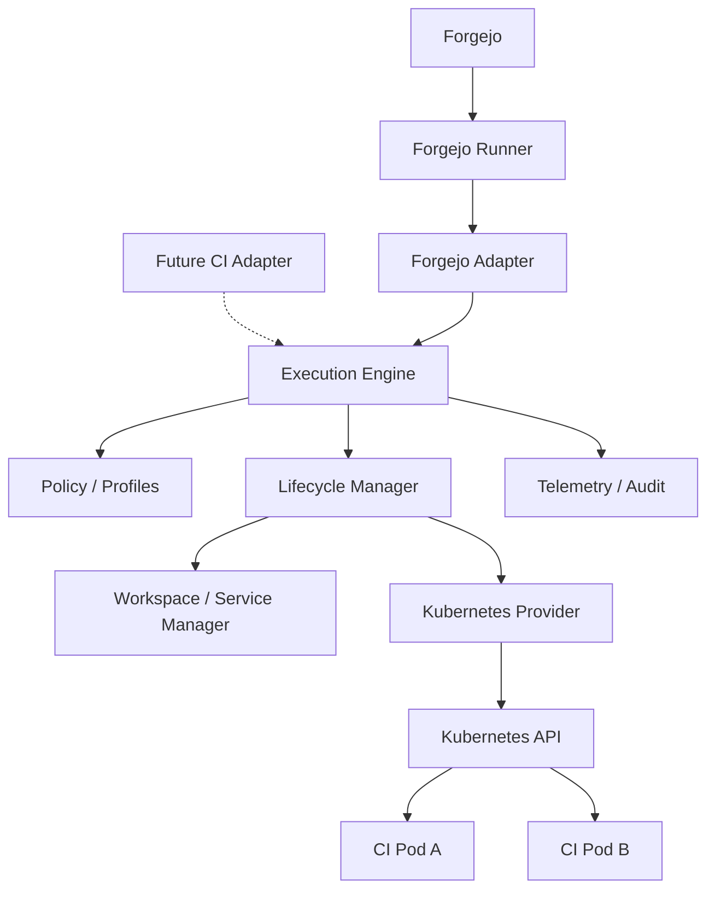

# Architecture Design Document — spawnPod

**Status:** Proposed target architecture. This is a design, not an implemented system.

## 1. Context

The Forgejo Runner owns workflow semantics, step sequencing and CI status. The adapter translates external RPCs into spawnPod's internal contract. The engine owns environment semantics. The Kubernetes provider owns Pod/API details.

## 2. Component responsibilities

| Component | Owns | Must not own |
|---|---|---|
| `adapter/forgejo` | gRPC plugin contract, conversion, protocol errors | Kubernetes PodSpec construction |
| `engine` | environment lifecycle, operation ordering, cancellation semantics | Forgejo workflow parsing |
| `policy` | authorization, allowed profiles, resource/security validation | raw Kubernetes API calls |
| `profile` | operator-defined execution configuration | arbitrary workflow-controlled privilege grants |
| `workspace` | workspace lifecycle and file transfer contract | cross-job implicit shared storage |
| `provider/kubernetes` | API client, Pods, exec, copy, deletion, watch | CI protocol specifics |
| `reconcile` | discovery and cleanup of owned resources | deletion of unknown resources |
| `telemetry` | metrics, logs, traces, audit correlation | secrets in labels or logs |

## 3. Internal contracts (conceptual, no code)

**EnvironmentRequest:** source identity, idempotency key, image, services, profile reference, deadline and permitted options.

**Environment:** opaque ID, desired/observed state, ownership, resource handles, timestamps, workspace and capabilities.

**CommandRequest:** environment ID, command argv, env, workdir, permitted user, deadline and command ID.

**ExecutionResult:** stream of stdout/stderr and terminal exit status or infrastructure error.

**Provider:** provision, start, execute, copy, inspect, stop, destroy, enumerate owned resources.

**Policy:** evaluate identity and requested capabilities against configured profiles; return allow/deny and approved immutable settings.

These are domain concepts, **not** claims about the exact protobuf message layout.

## 4. Control and data planes

**Control plane:** runner ↔ adapter ↔ engine ↔ Kubernetes API. Kubernetes credentials exist only in spawnPod's provider identity.

**Data plane:** command streams, file tar streams, workspace volumes, optional service traffic. Large transfers require bounded memory and backpressure; avoid storing complete archives in RAM.

## 5. Pod design

One job Pod per environment holds the supervisor and `emptyDir` workspace; sequential steps execute there. Each required service gets a separate Pod and ClusterIP Service. The job Pod receives a generated host alias for the service name. No automatic service-account token mount. Pod labels encode stable ownership, integration and environment ID, but not secrets. See [ADR-0003](../decisions/0003-execution-contract.md) and [ADR-0004](../decisions/0004-workload-topology-and-compatibility.md).

The supervisor explicitly cancels process groups and deletes the job Pod as a backstop. User switching beyond the profile UID and arbitrary image entrypoint behavior are unsupported. A ConfigMap record stores environment management state; see the ADRs for exact semantics and proof obligations.

## 6. Dependency direction

`adapter → engine contracts ← kubernetes provider` is the intended dependency rule. The domain should not import Forgejo generated protobuf types or Kubernetes `corev1.Pod` types. Interface placement will be decided when concrete use cases are implemented; do not create abstract packages without consumers.

## 7. Deployment topology

- `prod`: Forgejo application.
- `infra`: official Forgejo Runner + spawnPod control plane.
- `ci`: ephemeral job Pods, ResourceQuota, LimitRange, NetworkPolicies, admission policies.

Runner does not need Kubernetes credentials. spawnPod ServiceAccount has namespace-scoped permissions required for provisioning/exec/cleanup. A Pod-creation permission is sensitive even when scoped; admission policies are required.

## 8. Concurrency and state

Per-environment operations use one active operation slot. A cancelled streaming RPC handler may still be terminating when `Remove` begins; `Remove` sets terminating intent and cancels the active operation before waiting for its slot, avoiding a lock that blocks cancellation. One active controller replica is supported; record updates use ConfigMap `resourceVersion` and resource UID checks. A Kubernetes Lease is required before a standby replica can become active. Interrupted output streams are not resumed or replayed.

## 9. Failure semantics

Use structured categories: validation, policy denied, not found, unavailable, scheduling, image pull, command exit, execution transport, timeout, cancellation and cleanup. Retry only operations with understood idempotency. Never blindly replay an `Exec` request after a transport failure.

## 10. Verification strategy

Unit tests for policy/state transitions, fake-client tests for provider calls, kind/K3s integration tests for Pod lifecycle and RBAC, end-to-end tests against supported Forgejo Runner versions, fault injection for restarts and API interruptions.
