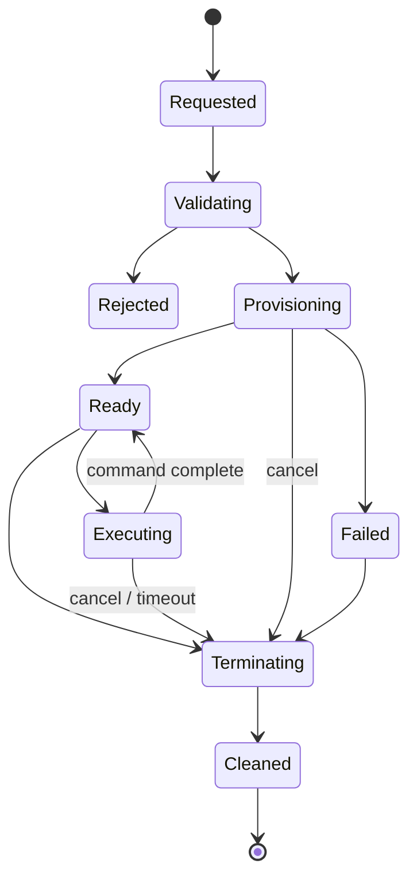

# Environment lifecycle and operation semantics

**Status:** Accepted design contract; supervisor, job Pod provider and basic engine are implemented, while the Forgejo adapter and full lifecycle remain pending. Protocol specifics are tracked in [integration notes](../integrations/forgejo.md).

`Ready` can recur between commands. An exit code != 0 is a command outcome, not necessarily environment infrastructure failure. Terminal states and cleanup status must be distinguishable.

## Create

Validate request and authenticated runner identity, resolve an immutable authorized profile, assign a random environment ID, create the ConfigMap record, then create service resources and the job Pod. Discover by environment ID and UID after an API timeout. Internal callers may pass an idempotency key; the observed Forgejo request cannot guarantee one. Readiness requires the job supervisor and required services.

## Start

Wait for readiness and return `StartComplete` with the available image environment (an empty map is valid). Workspace paths and OS/architecture metadata are returned from Create. Exact output/order is a Forgejo compatibility test.

## Exec

Serialize operations per environment. The in-container supervisor starts a process group, applies a command deadline, streams stdout/stderr with bounded backpressure and returns a distinct exit result. Explicit cancellation signals the group and waits for reaping. If this cannot be proved within the cleanup bound, delete the job Pod and fail the environment. A lost stream yields an indeterminate outcome; never retry Exec automatically. See [ADR-0003](../decisions/0003-execution-contract.md).

## CopyIn / CopyOut

Stream tar under `/workspace` using no-follow, directory-relative extraction; reject absolute/parent traversal, hardlinks, special files and symlink escapes. Cap bytes and entries, mask modes and assign profile UID/GID. Stage inbound files and clean incomplete transfers. Avoid buffering entire archives.

## Remove

Mark terminating, stop in-flight commands, delete all UID-matched owned resources, observe deletion or report partial failure. Repeat removal safely through a 24-hour tombstone. Reconciliation retries failed cleanup without touching foreign resources.

## Recovery

On restart, list owned resources, compare them with ConfigMap records and deadlines, resume management of idle environments or clean up. An interrupted command/output stream is indeterminate and is not resumed; terminate that environment.

## Timeouts

Separate environment lifetime, provisioning, command execution, cleanup and network/RPC deadlines. A caller cancellation should propagate promptly but not skip safe resource cleanup.
